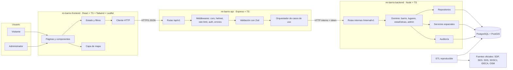
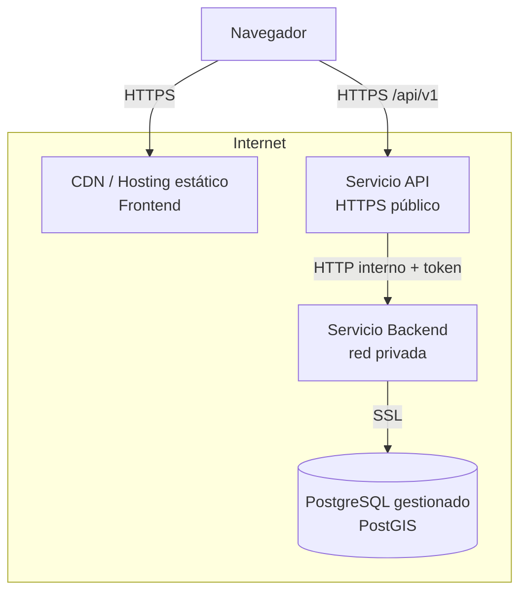
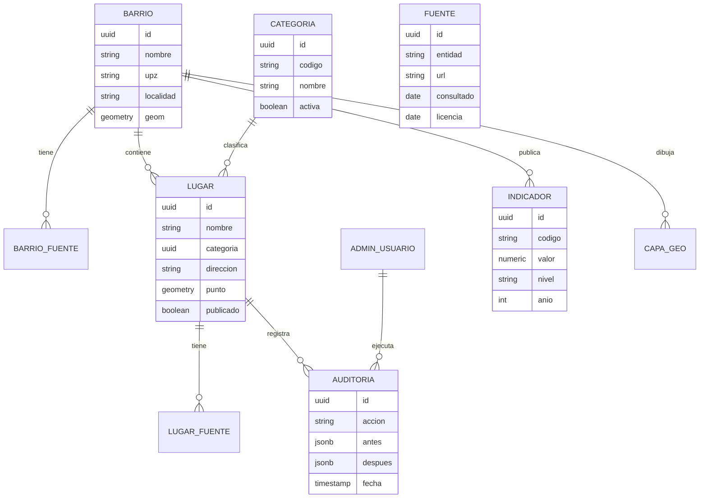

# Arquitectura de la solución — Mi Barrio, Ciudad Granada

**Versión:** 1.2 · **Fecha:** 2026-11-22

> **Estado vigente a 23 de noviembre de 2026:** D-2…D-7 aprobadas; D-7 implementada con evidencia técnica; Fases 1–14.7 ejecutadas y despliegue gratuito en Render ejecutado en Fase 15.2. La matriz canónica de Fase 13 registra 46/46 criterios aprobados acumulados y el run E2E remoto `44979541605` es regresión, no ejecución individual de los 46. **P0-01 APROBADO en Fase 15.3; P0-02 aprobado para la integridad consultada. Siguen pendientes documentación final, PT-01, PT-02, auditoría WCAG formal y aceptación académica.** La versión 1.1 (2026-11-15) registraba D-7 pendiente y Fase 1 en pruebas; se conserva como registro histórico. Ver [`../despliegue/evidencia-fase-15.3-correccion-p0-01-y-secciones.md`](../despliegue/evidencia-fase-15.3-correccion-p0-01-y-secciones.md).
**Alcance:** organización arquitectónica que debe soportar las 13 historias de usuario.

---

## 1. Decisiones de arquitectura (ADR)

| ID | Decisión | Alternativas | Estado | Justificación |
|----|----------|--------------|--------|---------------|
| D-1 | Repositorio `mi-barrio-docs` separado para documentación | Monorepo · docs dentro del backend | **Documentada (implícita)** | El usuario pidió guardar los resultados en el repositorio de documentación; separa artefactos académicos del código |
| D-2 | Especificaciones en Markdown + contratos tipados en código | OpenSpec oficial · formato del docente (`config.yaml` + `.ts`) | ✅ **Aprobada (2026-11-15)** | Se conservan las convenciones del docente (contratos por módulo, estado tipado) sin adoptar su scaffold incompleto (ver Fase 1, H-1..H-12) |
| D-3 | Tres repositorios independientes | Monorepo | ✅ **Aprobada (2026-11-15; restricción del profesor)** | Sin dependencias de código entre repos; contratos por HTTP |
| D-4 | PostgreSQL 16 + PostGIS 3.7.0 | MySQL 8 · SQLite + SpatiaLite | ✅ **Aprobada (2026-11-15)** | Ver §8; versión local verificada |
| D-5 | API y Backend se comunican por HTTP interno autenticado | Backend como librería del API | ✅ **Aprobada (2026-11-15)** | Mantiene capas desplegables e independientes; el API no importa código del backend |
| D-6 | Frontend React + TypeScript + Vite + Tailwind + Leaflet | Next.js · Angular | ✅ **Aprobada (2026-11-15)** | SPA suficiente, mapa ligero, build simple, sin SSR innecesario |
| D-7 | Autenticación de administrador con JWT corto + refresh + Argon2 | Sesión en servidor · OAuth | ✅ **Aprobada e implementada (2026-11-22)** | Simple, stateless, compatible con dos servicios; no bloqueó HU-01/HU-02. Evidencia: `adminAuth.ts`, `JwtService.ts`, `LoginAdmin.ts` y `main.ts` de `mi-barrio-backend`; §4 de [`../evidencias/fase-8/auditoria-integral.md`](../evidencias/fase-8/auditoria-integral.md) y regresión remota de [`../evidencias/fase-14-7/ejecucion-e2e-remota.md`](../evidencias/fase-14-7/ejecucion-e2e-remota.md). No implica despliegue. |

> **Estado de las decisiones (2026-11-15, registro histórico):** D-2…D-6 aprobadas. D-7 quedaba pendiente para la fase en que se implemente la administración y no bloquea HU-01/HU-02. La Fase 1 está implementada y en pruebas con HU-01/HU-02; los tres repositorios son independientes y tienen commits locales. No se inició la Fase 2 ni se declaró ninguna historia `Validada`.

> **Estado vigente (2026-11-22):** D-7 pasa de `Pendiente` a `Aprobada e implementada` usando evidencia ya existente, sin inventar resultados ni fechas. D-1 se mantiene documentada implícitamente. El estado histórico de la versión 1.1 se conserva arriba y en la documentación de fases anteriores.

---

## 2. Vista de capas

| Capa | Repositorio | Responsabilidad | Puede | No puede |
|------|-------------|-----------------|-------|----------|
| Presentación | `mi-barrio-frontend` | Render, estado de UI, mapa, accesibilidad | Consumir el API público; validar formularios | Acceder a la base; contener reglas de negocio |
| Aplicación / servicios | `mi-barrio-api` | Puerta de entrada pública: validación, autenticación, autorización, rate limit, composición de respuestas | Orquestar llamadas al backend; mapear DTO | Consultar la base; contener SQL; decidir reglas de dominio |
| Lógica y persistencia | `mi-barrio-backend` | Dominio, reglas, consultas espaciales, persistencia, auditoría | Acceder a PostGIS; ejecutar ETL; exponer API interna | Atender Internet directamente; renderizar |

> **Regla de dependencia:** Frontend → API → Backend → Base de datos. Nunca en sentido contrario. El backend no conoce al frontend; el API no conoce el esquema de la base.

---

## 3. Diagrama de componentes



---

## 4. Diagrama de despliegue



- Frontend: hosting estático (Vercel, Netlify o Cloudflare Pages).
- API: servicio con URL pública (Render, Railway o Fly.io).
- Backend: servicio sin exposición pública; solo accesible por el API.
- Base: PostgreSQL gestionado con PostGIS (Neon, Supabase o Railway).
- Secretos por variables de entorno; nunca en el repositorio.

---

## 5. Contrato del API público

Base: `/api/v1`. Formato: JSON UTF-8. Fechas ISO 8601.

| Método | Ruta | Auth | Descripción | HU |
|--------|------|------|-------------|----|
| GET | `/health` | No | Estado del servicio | — |
| GET | `/barrio` | No | Ficha territorial con fuentes | HU-01 |
| GET | `/barrio/geometria` | No | GeoJSON del polígono oficial | HU-02 |
| GET | `/categorias` | No | Categorías publicadas con conteo | HU-03, HU-12 |
| GET | `/lugares` | No | Listado paginado; `?categorias=a,b&q=&page=&limit=` | HU-03, HU-04, HU-12 |
| GET | `/lugares/{id}` | No | Detalle de un lugar | HU-03 |
| GET | `/geo/vias` | No | GeoJSON de la malla vial | HU-08 |
| GET | `/estadisticas/demografia` | No | Indicadores con nivel territorial | HU-10 |
| GET | `/estadisticas/seguridad` | No | Cuadrante e indicadores agregados | HU-11 |
| POST | `/auth/login` | No | Credenciales → token | HU-13 |
| POST | `/auth/logout` | Sí | Invalida el refresh | HU-13 |
| POST | `/admin/lugares` | Sí | Crea lugar | HU-13 |
| PATCH | `/admin/lugares/{id}` | Sí | Edita lugar | HU-13 |
| DELETE | `/admin/lugares/{id}` | Sí | Elimina lógicamente | HU-13 |
| PATCH | `/admin/lugares/{id}/publicacion` | Sí | Publica o despublica | HU-13 |
| POST/PATCH/DELETE | `/admin/categorias` | Sí | Gestión de categorías | HU-13 |

### 5.1 Envelope de éxito

```json
{ "data": { }, "meta": { "page": 1, "limit": 20, "total": 42 } }
```

### 5.2 Envelope de error

```json
{
  "error": {
    "code": "PLACE_NOT_FOUND",
    "message": "El lugar solicitado no existe.",
    "details": [],
    "requestId": "req_01J..."
  }
}
```

### 5.3 Códigos de error estables

| HTTP | Código | Uso |
|------|--------|-----|
| 400 | `VALIDATION_ERROR` | Campos inválidos; `details` por campo |
| 401 | `UNAUTHENTICATED` | Sin token o token inválido |
| 403 | `FORBIDDEN` | Rol insuficiente |
| 404 | `RESOURCE_NOT_FOUND` | Recurso inexistente |
| 409 | `CONFLICT` | Categoría con lugares, duplicado |
| 422 | `GEOMETRY_OUT_OF_BOUNDS` | Coordenada fuera del área de influencia |
| 429 | `RATE_LIMITED` | Límite excedido |
| 500 | `INTERNAL_ERROR` | Fallo no controlado (sin trazas al cliente) |
| 503 | `DEPENDENCY_UNAVAILABLE` | Backend o base no disponible |

### 5.4 Contrato interno (API → Backend)

Mismos recursos bajo `/internal/v1`, protegidos con token de servicio (`X-Service-Token`) y `X-Request-Id`. El API transforma y valida; el backend responde con el mismo envelope. El backend **no** emite tokens de usuario.

---

## 6. Mapa de módulos (≤ 100 líneas por archivo)

### 6.1 Frontend

| Módulo | Archivos previstos | Responsabilidad |
|--------|--------------------|-----------------|
| `app` | rutas, layout, providers | Composición y navegación |
| `features/barrio` | página, tarjeta, hook, servicio | HU-01 |
| `features/map` | mapa, capa polígono, capa vías, leyenda | HU-02, HU-08 |
| `features/places` | listado, detalle, tarjeta, hook, servicio | HU-03..07, HU-09 |
| `features/filters` | panel, chips, reducer | HU-12 |
| `features/stats` | página, gráficos, etiqueta de nivel | HU-10, HU-11 |
| `features/admin` | login, formulario, tabla, guard | HU-13 |
| `shared` | cliente HTTP, tipos, utilidades, componentes UI | Transversal |

**Estrategia de 100 líneas:** un componente por archivo; hooks y servicios separados; tipos en `types/`; sin lógica de negocio en componentes.

### 6.2 API

| Módulo | Archivos previstos | Responsabilidad |
|--------|--------------------|-----------------|
| `routes` | un archivo por recurso | Declaración de endpoints |
| `controllers` | un archivo por caso de uso | Traducir HTTP ↔ caso de uso |
| `schemas` | un archivo por recurso | Validación Zod |
| `middlewares` | auth, errores, rate limit, request-id | Transversal |
| `clients` | backend client | HTTP interno |
| `mappers` | DTO ↔ respuesta | Formato |

### 6.3 Backend

| Módulo | Archivos previstos | Responsabilidad |
|--------|--------------------|-----------------|
| `domain/barrio` | entidad, servicio, repositorio | Ficha y geometría |
| `domain/places` | entidad, servicio, repositorio, filtros | Catálogo |
| `domain/stats` | servicio, repositorio | Demografía y seguridad |
| `domain/admin` | servicio, repositorio, auditoría | CRUD y trazabilidad |
| `domain/auth` | servicio, repositorio | Credenciales y tokens |
| `infra/db` | pool, migraciones, consultas espaciales | PostGIS |
| `etl` | un archivo por fuente | Carga reproducible |
| `http` | rutas internas, validación, errores | API interna |

---

## 7. Principios SOLID aplicados

| Principio | Aplicación concreta |
|-----------|---------------------|
| **S** — Responsabilidad única | Un archivo = un caso de uso o un componente. El controlador no valida ni consulta la base. |
| **O** — Abierto/cerrado | Las categorías y fuentes se agregan por configuración/datos, no modificando el código de filtros. |
| **L** — Sustitución de Liskov | Repositorios con interfaz común (`findById`, `search`) intercambiables entre implementación PostGIS y dobles de prueba. |
| **I** — Segregación de interfaces | Interfaces pequeñas por dominio (`BarrioReader`, `PlaceWriter`, `StatsReader`), no una interfaz gigante. |
| **D** — Inversión de dependencias | El dominio depende de interfaces de repositorio; la infraestructura las implementa. |

**Cohesión y acoplamiento:** cada módulo agrupa lo que cambia junto; la comunicación entre capas es por contratos HTTP y DTO, sin compartir modelos internos.

---

## 8. Evaluación de la base de datos

| Criterio | PostgreSQL + PostGIS | MySQL 8 | SQLite + SpatiaLite |
|----------|----------------------|---------|---------------------|
| Funciones espaciales | Completas (`ST_Contains`, `ST_DWithin`, `ST_Intersects`, `ST_AsGeoJSON`) | Básicas | Amplias, pero de un solo archivo |
| SRID y reproyección | Nativo, `geometry`/`geography` | Limitado | Depende de extensión |
| Índices espaciales | GiST/SP-GiST maduros | R-tree | R-tree |
| GeoJSON | `ST_AsGeoJSON` nativo | `ST_AsGeoJSON` | Vía extensión |
| Concurrencia multiusuario | Alta (MVCC) | Alta | Un escritor; no apto para admin web |
| Hosting gestionado | Amplio (Neon, Supabase, Railway) | Amplio | Prácticamente inexistente |
| Madurez GIS | Estándar de facto | Menor | Prototipos |
| Costo | Gratuito / capa gratuita | Gratuito / capa gratuita | Gratuito |
| **Veredicto** | **Recomendada** | Viable, no óptima | No recomendada para producción |

**Decisión D-4:** PostgreSQL + PostGIS. Motivos: consultas espaciales verificables (RNF-17), salida GeoJSON directa para Leaflet, índice GiST para filtros por área y hosting gestionado con HTTPS.

---

## 9. Modelo de datos conceptual



Reglas de persistencia: SRID 4326, índices GiST en `geom` y `punto`, borrado lógico de lugares, auditoría inmutable, claves foráneas con integridad referencial.

> El modelo entidad-relación completo, con DDL y diccionario de datos, corresponde a la Fase 4.

---

## 10. Seguridad

| Control | Implementación |
|---------|----------------|
| Validación de entrada | Zod en API; validación de dominio en backend |
| Autenticación | JWT de acceso corto + refresh rotativo; hash de contraseña con Argon2 |
| Autorización | Rol `admin` verificado en middleware; backend valida token de servicio |
| Rate limiting | Por IP y por usuario en login y escritura |
| Cabeceras | Helmet, CORS con lista blanca, HSTS en producción |
| Inyección SQL | Consultas parametrizadas; sin concatenación |
| Secretos | Variables de entorno; `.env` fuera del repositorio; rotación documentada |
| Errores | Sin trazas ni SQL al cliente; `requestId` para correlación |
| Auditoría | Registro de quién, qué, cuándo y valores anteriores |
| Datos personales | No se recolectan datos de visitantes; solo credenciales de administrador |

---

## 11. Accesibilidad y adaptabilidad

- HTML semántico, landmarks, jerarquía de encabezados.
- Contraste AA, foco visible, navegación por teclado, `aria-label` en controles del mapa.
- Texto alternativo en marcadores y gráficos; tablas con encabezados.
- Diseño mobile-first con puntos de quiebre en 640, 768, 1024 y 1280 px.
- Mapa con alternativa textual: lista de lugares siempre disponible.

---

## 12. Manejo de errores

1. **Frontend:** captura errores del cliente HTTP, muestra mensaje accionable y `requestId`; no bloquea la navegación.
2. **API:** middleware único traduce excepciones a `error.code`; registra con `requestId`.
3. **Backend:** errores de dominio tipados (`NotFound`, `Conflict`, `Validation`); los inesperados se registran y se devuelven como `INTERNAL_ERROR`.
4. **Base:** fallos de conexión → `DEPENDENCY_UNAVAILABLE` con reintento acotado.

---

## 13. Estrategia de pruebas

| Nivel | Dónde | Herramienta prevista | Qué cubre |
|-------|-------|----------------------|-----------|
| Unitaria | Backend y API | Vitest | Reglas, mappers, validadores |
| Integración | Backend + PostGIS | Vitest + base efímera | Consultas espaciales, transacciones |
| API | API | Supertest | Contratos, códigos, auth |
| Funcional (E2E) | Frontend | Playwright | Recorridos de las 13 HU |
| Geográfica | Backend | Scripts de validación | Vértices, área, centroide, SRID |
| Seguridad | API | Supertest + casos | 401/403, rate limit, validación |
| Rendimiento | API/Frontend | k6 + Lighthouse | p95 y carga inicial |
| Accesibilidad | Frontend | axe-core + revisión manual | WCAG 2.1 AA |

**Puertas de calidad en CI:** lint, tipos, pruebas, cobertura mínima acordada, conteo de líneas ≤ 100 y build de producción.

---

## 14. Riesgos arquitectónicos

| Riesgo | Probabilidad | Impacto | Mitigación |
|--------|--------------|---------|------------|
| Backend expuesto por error | Media | Alto | Red privada, token de servicio, revisión de configuración |
| Consultas espaciales lentas | Media | Medio | Índices GiST, límites de radio, caché de capas |
| Dependencia de fuentes externas | Alta | Medio | ETL con respaldo local y fecha de corte |
| Límite de 100 líneas fuerce sobre-fragmentación | Media | Bajo | Cohesión por caso de uso, no por línea |
| Costos de hosting | Baja | Medio | Capas gratuitas y presupuesto documentado |
| Datos de terceros con licencia | Baja | Alto | Atribución visible y registro de licencias (RN-07) |

---

## 15. Criterios de aceptación de la arquitectura

1. Tres repositorios sin imports cruzados.
2. Frontend no contiene cadenas SQL ni secretos.
3. API no contiene SQL ni reglas de dominio.
4. Backend no atiende tráfico público.
5. Base con SRID 4326 e índices GiST verificados.
6. Todo archivo de código ≤ 100 líneas (verificado en CI).
7. Contrato de error único y códigos estables.
8. Diagramas y decisiones versionados en `mi-barrio-docs`.

**Estado histórico (2026-11-15):** propuesta; en ese momento no había componentes implementados.

**Estado vigente a 22 de noviembre de 2026:** la topología se implementó y validó técnicamente en Fases 1–14.7, pero **no está desplegada**; PT-01, PT-02, la auditoría WCAG formal y la aceptación académica siguen pendientes.
