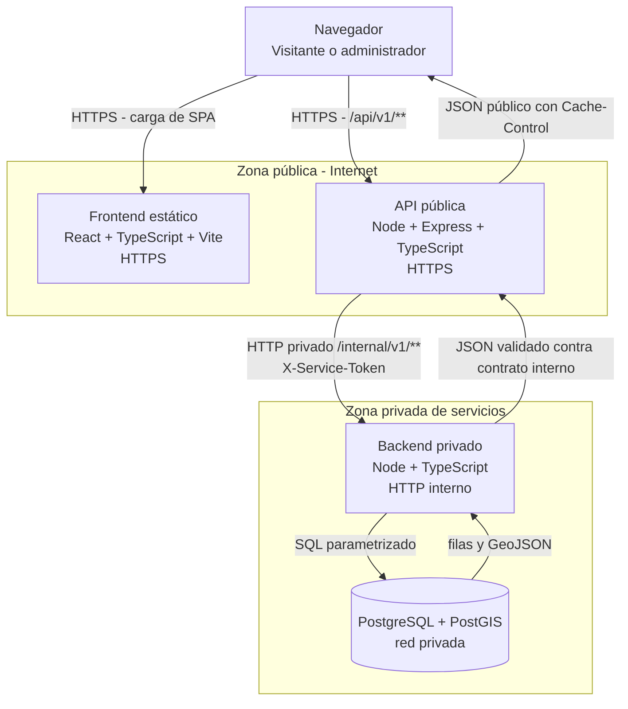

# Arquitectura propuesta de despliegue — Mi Barrio, Ciudad Granada

**Versión 1.0 — 2026-11-22**  
**Estado: PROPUESTA. No implementada, no desplegada, sin proveedor ni dominio seleccionado.**

Este documento diseña una arquitectura de despliegue viable para los tres repositorios existentes, tomando como fuente principal la [auditoría del estado de despliegue](auditoria-estado-despliegue.md) y contrastándola con el código y la documentación vigente. No crea infraestructura, no modifica contratos ni añade dependencias.

Convención usada en todo el documento:

- **[EXISTENTE]**: comprobado en código, contratos, workflows o documentación aprobada.
- **[PROPUESTA]**: diseño pendiente de decisión, autorización e implementación.
- **[NO VERIFICADO]**: no hay evidencia suficiente en el workspace.

---

## 1. Objetivo y alcance

### 1.1 Objetivo

Definir cómo ejecutar Mi Barrio – Ciudad Granada de forma controlada y verificable manteniendo la separación de responsabilidades ya acordada: interfaz pública, API pública, backend privado y base espacial.

### 1.2 Alcance

Incluye:

- Topología lógica de los cuatro componentes.
- Flujo de una solicitud desde el navegador hasta PostgreSQL/PostGIS y de vuelta.
- Fronteras públicas/privadas, CORS, HTTPS, DNS y TLS.
- Comunicación API → Backend y autenticación administrativa.
- Variables de entorno, secretos y permisos por servicio.
- Entornos de desarrollo, staging y producción.
- Persistencia, health checks, logs, monitorización y alertas.
- Decisiones, supuestos, riesgos y validaciones previas.

Excluye:

- Selección de proveedores, nombres de dominio, precios o contratos.
- Creación de Dockerfile, compose, manifiestos, workflows de publicación o recursos cloud.
- Cambios en contratos OpenAPI, código, `package.json` ni configuraciones existentes.
- Ejecución de despliegue o publicación de servicios.

### 1.3 Estado actual frente a la propuesta

| Ámbito | Estado según la auditoría | Tratamiento en este documento |
|---|---|---|
| Tres repositorios independientes y contratos HTTP | **[EXISTENTE]** | Se conserva sin cambios |
| CORS, `X-Service-Token`, JWT, health checks y rate limit | **[EXISTENTE]** en código | Se reutiliza; no se rediseña |
| Dockerfile, compose o manifiestos | **Ausentes** | Se propone definirlos, sin crearlos aquí |
| Workflows de publicación/despliegue | **Ausentes** | Se propone su futura incorporación |
| Dominio, DNS, certificados y proveedores | **[NO VERIFICADO]** | Se usan marcadores, nunca nombres inventados |
| Respaldo, logs agregados, monitorización y alertas | **Ausentes** | Se proponen como capacidades a incorporar |

La [guía de despliegue existente](../manuales/manual-despliegue.md) ya describe una arquitectura propuesta compatible con este diseño; este documento la desarrolla sin contradecirla ni duplicar su procedimiento operativo.

---

## 2. Arquitectura lógica de los tres niveles

### 2.1 Frontend React + TypeScript

- **[EXISTENTE]** Aplicación SPA construida con Vite, React 19, TypeScript estricto, Tailwind CSS 4 y Leaflet/React Leaflet.
- **[EXISTENTE]** El artefacto publicable es `dist/`, generado por `npm run build`.
- **[EXISTENTE]** `VITE_API_BASE_URL` se consume en tiempo de compilación mediante `import.meta.env`; cambiarlo exige reconstruir el frontend.
- **[EXISTENTE]** En desarrollo, Vite proxya `/api` a `http://127.0.0.1:3000` (`vite.config.ts`).
- **[PROPUESTA]** En staging y producción, el frontend se sirve como contenido estático por HTTPS desde el punto de entrega que se seleccione. No se elige proveedor en este documento.
- **[PROPUESTA]** El navegador llama a la API mediante un nombre de dominio aprobado, nunca a `localhost`.

### 2.2 API Node.js + Express + TypeScript

- **[EXISTENTE]** Frontera pública bajo `/api/v1`; expone health, ficha, geometría, lugares, vías, estadísticas, autenticación y administración.
- **[EXISTENTE]** Middlewares verificados: `helmet()`, `cors` con un único origen, `requestId`, `express-rate-limit`, límite de cuerpo JSON de 8 kb, caché pública en rutas GET y manejo centralizado de errores.
- **[EXISTENTE]** No tiene dependencia de base de datos: solo habla HTTP con el backend.
- **[EXISTENTE]** Valida las respuestas internas con Ajv antes de reexponerlas como contrato público.
- **[PROPUESTA]** Se ejecuta como servicio accesible desde Internet únicamente por HTTPS, sin acceder directamente a la base ni al panel de administración del backend.

### 2.3 Backend Node.js + TypeScript

- **[EXISTENTE]** Expone `/internal/v1/**`, protegido por `X-Service-Token` en todo el router interno.
- **[EXISTENTE]** Contiene dominio, repositorios PostgreSQL, ETL, autenticación JWT, auditoría y health interno.
- **[EXISTENTE]** Escucha por defecto en `HOST=0.0.0.0:3001` para poder funcionar en red de servicios.
- **[PROPUESTA]** Permanece en red privada: sin puerto publicado, sin CORS público y sin exposición a Internet. Solo la API puede alcanzarlo.
- **[PROPUESTA]** Las migraciones y el ETL se ejecutan como pasos controlados antes de abrir tráfico, no de forma automática en cada arranque no supervisado.

### 2.4 PostgreSQL + PostGIS

- **[EXISTENTE]** PostgreSQL 16 + PostGIS 3.7.0 es la base documentada y usada por el backend.
- **[EXISTENTE]** Migraciones `001`–`009` idempotentes mediante `schema_migrations`; ETL transaccional con verificación de hashes de snapshots.
- **[EXISTENTE]** La API no consulta la base; solo el backend usa `pg`.
- **[NO VERIFICADO]** No existe una instancia gestionada configurada ni credenciales de producción.
- **[PROPUESTA]** Base de datos en red privada, accesible solo por el backend, con extensión PostGIS habilitada antes de ejecutar migraciones.

---

## 3. Diagrama de arquitectura con Mermaid

Leyenda: las flechas hacia `Backend` y `PostgreSQL` que cruzan la frontera de la zona privada representan el requisito de red, no una topología ya desplegada.

---

## 4. Flujo de solicitudes desde el navegador hasta la base de datos y respuesta

1. **Resolución y carga inicial.** El navegador resuelve el dominio público del frontend **[PROPUESTA: dominio pendiente de aprobación]**, establece TLS y descarga `dist/`. No hay dominio verificado en la auditoría.
2. **Llamada a la API.** La SPA construye la URL con `VITE_API_BASE_URL` **[EXISTENTE]** y solicita `/api/v1/**` por HTTPS. En desarrollo se usa el proxy `/api` de Vite; en staging/producción se usa el dominio de la API.
3. **Frontera de API.** La API aplica `helmet()`, CORS con `FRONTEND_ORIGIN`, `requestId`, rate limit y límite de cuerpo. Una petición de otro origen es rechazada por CORS; un exceso de solicitudes devuelve `429 DEMASIADAS_SOLICITUDES`.
4. **Caso de uso.** El controlador público invoca el caso de uso correspondiente; este llama al puerto `BarrioBackendPort` o al cliente administrativo.
5. **Llamada interna.** `BackendClient` / `AdminBackendClient` envían la petición a `BACKEND_URL` con `X-Service-Token` y, para Rutas administrativas, `Authorization: Bearer <token>`. El timeout es de 5 segundos **[EXISTENTE]**.
6. **Protección del backend.** `requireServiceToken` compara el token con `timingSafeEqual`; si falta o no coincide, responde `401 NO_AUTORIZADO`. En rutas administrativas, `adminAuth` verifica además el JWT de acceso.
7. **Persistencia.** Los repositorios del backend ejecutan SQL parametrizado contra PostgreSQL/PostGIS. Los datos territoriales provienen del ETL reproducible y los cambios administrativos se registran en `auditoria`.
8. **Validación de contrato.** La respuesta interna se valida con Ajv. Si no cumple el contrato interno, la API devuelve `502 CONTRATO_INTERNO_INVALIDO` y no expone detalles internos.
9. **Respuesta pública.** La API mapea la respuesta al contrato público; las rutas GET públicas añaden `Cache-Control: public, max-age=300, stale-while-revalidate=60` **[EXISTENTE]**. El navegador renderiza la ficha, el mapa o el panel administrativo.
10. **Errores.** Las respuestas de error incluyen `code`, `message` y `requestId` **[EXISTENTE]**; la correlación se realiza con la cabecera `X-Request-Id`.

> Este flujo describe el comportamiento del código actual más el emplazamiento propuesto. **No implica que el flujo esté ejecutándose en un entorno desplegado.**

---

## 5. Separación entre servicios públicos y privados

| Componente | Exposición propuesta | Quién puede llamarlo | Protección | Estado |
|---|---|---|---|---|
| Frontend | Pública, HTTPS | Navegadores | TLS, cabeceras del hosting estático | **[PROPUESTA]** de publicación; artefacto `dist/` existe |
| API | Pública, HTTPS | Frontend y clientes autorizados | CORS de origen único, rate limit, Helmet, TLS | **[EXISTENTE]** en código; **sin dominio ni TLS verificados** |
| Backend | Privada, sin puerto público | Solo API | `X-Service-Token`, red privada, sin CORS | **[PROPUESTA]**; hoy solo es recomendación documentada |
| PostgreSQL + PostGIS | Privada | Solo backend | Red privada, credenciales en secretos | **[PROPUESTA]**; instancia no verificada |
| GitHub Actions | Entorno de ejecución, no producción | Repositorios | SHAs fijados y secretos de E2E | **[EXISTENTE]**; no publica ni despliega |

Regla de dependencia **[EXISTENTE]**: `Navegador → Frontend → API → Backend → Base de datos`. Nunca en sentido inverso. El backend no conoce al frontend y la API no conoce el esquema de la base.

---

## 6. Comunicación API → Backend mediante `X-Service-Token`

- **[EXISTENTE]** La API envía `X-Service-Token` en cada petición interna, tanto en lecturas como en operaciones administrativas.
- **[EXISTENTE]** El backend aplica `requireServiceToken` a todo `/internal/v1`, usando comparación de tiempo constante y respondiendo `401 NO_AUTORIZADO` si el token falta o es incorrecto.
- **[EXISTENTE]** El mismo token debe estar disponible en API y backend; no se almacena en el repositorio y no se envía al navegador.
- **[EXISTENTE]** La API valida las respuestas internas con el contrato y el timeout de 5 segundos mitigan respuestas inesperadas o servicios caídos.
- **[PROPUESTA]** En red de contenedores se usará un nombre interno resoluble, por ejemplo `http://mi-barrio-backend:3001`, tal como ya documentan los README y el contrato interno. **Es un ejemplo de topología, no un servicio creado.**
- **[PROPUESTA]** El backend no publicará su puerto al host ni a Internet; la API será la única frontera pública.

---

## 7. Autenticación JWT y protección de rutas administrativas

**[EXISTENTE]**

- `JwtService` firma tokens de acceso con 15 minutos de vigencia y tokens de refresco con 7 días, usando secretos distintos.
- `ADMIN_USERNAME` / `ADMIN_PASSWORD` son opcionales y, si se proporcionan, crean un usuario administrador con hash Argon2 al arrancar el backend.
- `/api/v1/auth/login` y `/api/v1/auth/refresh` se reenvían al backend; la API no emite ni valida JWT por sí misma.
- Las rutas `/api/v1/admin/**` comprueban la presencia de `Bearer` en la API, pero **la validación criptográfica del token ocurre en el backend** mediante `adminAuth`.
- El backend registra acciones administrativas en la tabla `auditoria`.

**[PROPUESTA]**

- En staging y producción, el usuario administrador se creará mediante secreto inyectado en el arranque controlado, sin valores en repositorios ni documentos.
- Se mantendrá la validación en el backend como única autoridad; la API seguirá actuando como túnel autenticado.
- Antes de producción debe validarse la política de refresco y cierre de sesión: en el código revisado, `RefreshSession` verifica el JWT de refresco y emite un access token, pero **no se encontró almacenamiento, rotación ni revocación de refresh tokens**. Cualquier mecanismo de logout deberá diseñarse y aprobarse explícitamente sin cambiar los contratos actuales sin autorización.

---

## 8. CORS, HTTPS, DNS y certificados TLS

### 8.1 CORS

- **[EXISTENTE]** La API usa un único `FRONTEND_ORIGIN`; métodos `GET`, `POST`, `PUT`, `DELETE`; cabeceras `Content-Type` y `Authorization`; `maxAge` 86400.
- **[EXISTENTE]** El backend no configura CORS.
- **[PROPUESTA]** Definir un valor distinto de `FRONTEND_ORIGIN` por entorno (desarrollo, staging, producción) con el origen exacto aprobado. Los nombres `*.example` de las plantillas son ejemplos no desplegados.
- **[PROPUESTA]** No habilitar múltiples orígenes ni comodines sin una decisión formal.

### 8.2 HTTPS, DNS y TLS

- **[NO VERIFICADO]** No hay dominio, registro DNS, certificado ni entorno HTTPS documentado como existente.
- **[PROPUESTA]** Publicar frontend y API bajo dominios aprobados, con terminación TLS en el punto de entrada de cada servicio.
- **[PROPUESTA]** Redirigir HTTP a HTTPS y renovar certificados mediante el mecanismo que ofrezca la plataforma final.
- **[PROPUESTA]** No publicar el backend por HTTPS ni exponer su puerto.
- **[PROPUESTA]** Confirmar HSTS en la capa de terminación TLS. El código aplica `helmet()` **[EXISTENTE]**, pero no se ha verificado una configuración HSTS explícita; no se afirmará que ya está activa.
- **[PROPUESTA]** La atribución de OpenStreetMap debe permanecer visible en el mapa.

---

## 9. Variables de entorno necesarias por servicio, sin valores secretos

Los nombres y requisitos proceden de `src/config/env.ts` y `.env.example` de cada repositorio. **No se muestran valores reales.**

### 9.1 Backend

| Variable | Carácter | Finalidad |
|---|---|---|
| `PORT` | Opcional, default `3001` | Puerto HTTP interno |
| `HOST` | Opcional, default `0.0.0.0` | Interfaz de escucha en red de servicios |
| `DATABASE_URL` | Obligatoria | Cadena de conexión a PostgreSQL/PostGIS |
| `SERVICE_TOKEN` | Obligatoria, ≥16 caracteres | Token compartido con la API |
| `JWT_SECRET` | Obligatoria, ≥16 caracteres | Firma de access tokens |
| `JWT_REFRESH_SECRET` | Obligatoria, ≥16 caracteres | Firma de refresh tokens |
| `ADMIN_USERNAME` / `ADMIN_PASSWORD` | Opcionales; contraseña ≥8 | Creación inicial del administrador |
| `NODE_ENV` | Opcional, default `development` | Entorno de ejecución |

### 9.2 API

| Variable | Carácter | Finalidad |
|---|---|---|
| `PORT` | Opcional, default `3000` | Puerto HTTP |
| `HOST` | Opcional, default `127.0.0.1` | En contenedores debe ajustarse a `0.0.0.0` |
| `BACKEND_URL` | Opcional, default local | URL privada del backend |
| `SERVICE_TOKEN` | Obligatoria, ≥16 caracteres | Debe coincidir con el backend |
| `FRONTEND_ORIGIN` | Opcional, default local | Origen único permitido por CORS |
| `RATE_LIMIT_MAX` | Opcional, default `120` | Solicitudes/minuto/IP; producción rechaza >120 |
| `NODE_ENV` | Opcional, default `development` | Activa validaciones de producción |

### 9.3 Frontend

| Variable | Carácter | Finalidad |
|---|---|---|
| `VITE_API_BASE_URL` | Opcional, vacío por defecto | Prefijo de la API pública; se fija en build |
| `PUBLIC_CONTRACT_PATH` | Opcional | Solo scripts de verificación de contrato |
| `E2E_ADMIN_USERNAME` / `E2E_ADMIN_PASSWORD` | Solo E2E | Credenciales de prueba, sin defaults |
| `E2E_TRACE` | Solo E2E | Control de trace de Playwright |

---

## 10. Gestión de secretos y permisos

**[EXISTENTE]**

- Los `.gitignore` excluyen `.env` y `.env.*`, con excepción de `.env.example`.
- Los `.env.example` usan marcadores de cambio, no credenciales reales.
- El repositorio frontend registra, solo por nombre en la evidencia, los secretos E2E `SERVICE_TOKEN`, `JWT_SECRET`, `JWT_REFRESH_SECRET`, `E2E_ADMIN_USERNAME` y `E2E_ADMIN_PASSWORD`. Esta auditoría **no verificó** su presencia actual en GitHub.

**[PROPUESTA]**

- Los secretos de producción se inyectarán en tiempo de ejecución desde el mecanismo de secretos de la plataforma final; nunca se versionarán ni se copiarán entre entornos.
- Se usarán valores distintos por entorno para `SERVICE_TOKEN`, JWT, credenciales de base y administrador.
- La API recibirá solo lo que necesita: `SERVICE_TOKEN`, `BACKEND_URL`, `FRONTEND_ORIGIN`, `RATE_LIMIT_MAX` y `NODE_ENV`. No recibirá credenciales de base ni secretos JWT.
- El backend recibirá `DATABASE_URL`, `SERVICE_TOKEN`, secretos JWT y, si aplica, credenciales de administrador.
- Se aplicará principio de menor privilegio: la identidad de base usada por el backend solo podrá leer/escribir el esquema de la aplicación; la API no tendrá acceso a la base.
- Se definirán rotación, revocado de tokens ante incidencia y registro de quién cambia cada secreto, sin imprimir valores en logs.
- Los secretos E2E no se reutilizarán como secretos de producción.

---

## 11. Arquitectura de desarrollo, staging y producción

| Aspecto | Desarrollo **[EXISTENTE]** | Staging **[PROPUESTA]** | Producción **[PROPUESTA]** |
|---|---|---|---|
| Frontend | Vite en `127.0.0.1:5173`, proxy `/api` | Build `dist/` servido por HTTPS | Build `dist/` servido por HTTPS desde el punto de entrega aprobado |
| API | `127.0.0.1:3000`, `BACKEND_URL` local | Servicio HTTPS con origen CORS de staging | Servicio HTTPS con origen CORS de producción |
| Backend | `127.0.0.1:3001`, base local `55432` | Servicio privado, sin puerto público | Servicio privado, sin puerto público |
| Base | PostgreSQL/PostGIS local | Instancia aislada con datos de prueba | Instancia privada con respaldo y PostGIShabilitado |
| Referencias | Rama local `main` | SHAs explícitos del E2E | SHAs aprobados y registrados antes de publicar |
| Secretos | `.env` local ignorado | Secretos del entorno de staging | Secretos del entorno de producción |
| Objetivo | Iteración y pruebas | Regresión con topología similar a producción | Uso público y aceptación final |

- El workflow E2E actual **[EXISTENTE]** ya usa SHAs fijados para backend y API; se propone conservar esa disciplina para cualquier promoción futura entre entornos.
- Staging y producción **no existen hoy**: no hay entorno HTTPS, proveedor, dominio ni job de publicación verificado.
- La regresión E2E documentada no sustituye la verificación de staging ni de producción.

---

## 12. Persistencia de datos y almacenamiento

| Dato | Situación actual | Propuesta |
|---|---|---|
| Datos territoriales y administrativos | PostgreSQL + PostGIS; migraciones y ETL en el repositorio | Base privada con almacenamiento persistente gestionado por la plataforma elegida |
| Snapshots fuente | Archivos versionados y verificados por `verify:data` | Se conservan como artefacto reproducible; no se sustituyen por respaldo |
| Cambios administrativos y auditoría | Tablas `admin_usuario` y `auditoria` | Deben incluirse en el respaldo; la reconstrucción desde snapshots no los conserva |
| Artefacto frontend | `dist/` generado en build | Publicarse como contenido estático inmutable por versión |
| Logs | `console.log` / `console.error`, redirigidos a archivos efímeros en E2E | Captura de stdout/stderr por la plataforma, sin librerías nuevas |
| Volúmenes | No hay definiciones en los repositorios | Definir almacenamiento duradero solo para la base; API y backend no requieren estado local |

**No existe** un procedimiento de respaldo o restauración en los repositorios. Se propone definir, antes de producción, frecuencia, retención, destino, cifrado y prueba de restauración. Cualquier mecanismo será una decisión de infraestructura pendiente, no una capacidad implementada.

---

## 13. Health checks, logs, monitorización y alertas

### 13.1 Existente

- API: `GET /api/v1/health`, público, responde `{"status":"ok","service":"mi-barrio-api"}`.
- Backend: `GET /internal/v1/health`, protegido por `X-Service-Token`, responde `{"status":"ok","service":"mi-barrio-backend"}`.
- No hay script npm propio de healthcheck.
- API y backend usan `console.log`/`console.error`; no hay agregación, rotación ni retención definida.
- El workflow E2E realiza hasta 60 intentos de health checks y publica un artefacto de Playwright.

### 13.2 Propuesta

- Sondas externas al health de la API por HTTPS desde la plataforma de ejecución.
- Sonda al health del backend desde la red privada, con el token inyectado como secreto; la petición sin token debe seguir fallando con `401`.
- Comprobación sintética de carga del frontend y de una ruta pública crítica.
- Captura de stdout/stderr de los tres procesos por la plataforma, con retención y control de acceso a decidir.
- Alertas propuestas: health fallido, incremento de respuestas `5xx`, exceso de `429`, latencia alta, saturación de conexiones a base, expiración de certificado y error de verificación de contrato.
- Correlación de incidencias mediante `requestId`.
- No se añadirá una librería de logging ni de monitorización al código; se usarán capacidades de la plataforma final.

---

## 14. Seguridad, disponibilidad, escalabilidad y mantenibilidad

### 14.1 Seguridad

- **[EXISTENTE]** Helmet, CORS de origen único, rate limit, `X-Service-Token`, JWT con secretos separados, Argon2, SQL parametrizado, sin trazas internas en errores públicos.
- **[PROPUESTA]** Terminación TLS, HSTS a confirmar, secretos por entorno, menor privilegio, backend y base sin exposición pública.
- **[PROPUESTA]** Verificar que las respuestas de error no incluyan tokens ni cadenas de conexión.
- **[PROPUESTA]** Mantener el límite de 100 líneas y `contracts:verify` como compuertas de calidad antes de promover una versión.

### 14.2 Disponibilidad

- **[PROPUESTA]** Reinicio automático de servicios ante fallo, sondas de salud y despliegue por versión con posibilidad de reversión a un SHA anterior.
- **[PROPUESTA]** Base con respaldo y prueba de restauración. No hay SLA definido en el workspace.
- **[EXISTENTE]** La API y el backend son procesos Node sin archivos de estado propios; la persistencia está en PostgreSQL.

### 14.3 Escalabilidad

- **[PROPUESTA]** El frontend estático puede servirse desde la capa de entrega de la plataforma seleccionada.
- **[PROPUESTA]** La API puede escalarse horizontalmente porque no accede a base ni mantiene sesión local.
- **[PROPUESTA]** El backend puede escalarse horizontalmente solo si se dimensiona el pool de conexiones y la base soporta la carga; debe medirse antes de aplicar autoscaling.
- **[PROPUESTA]** La base escalará según las capacidades de la plataforma final; no se asume réplica ni autoescalado existente.

### 14.4 Mantenibilidad

- **[EXISTENTE]** Contratos con hash SHA-256, CI en los tres repositorios, E2E con SHAs fijados, manuales operativos y límite de 100 líneas.
- **[PROPUESTA]** Toda promoción registrará HEAD, hash de contratos, entorno, resultado de health checks y responsable.
- **[PROPUESTA]** No se introducirán dependencias nuevas: la propuesta reutiliza los scripts y tecnologías ya presentes en `package.json`.

---

## 15. Decisiones arquitectónicas, supuestos y riesgos

### 15.1 Decisiones

| ID | Decisión | Clasificación |
|---|---|---|
| DA-1 | Mantener tres repositorios independientes y comunicación solo por HTTP | **[EXISTENTE]** |
| DA-2 | API como única frontera pública; backend privado | **[EXISTENTE]** como diseño, **[PROPUESTA]** su aplicación infraestructural |
| DA-3 | `X-Service-Token` para API → Backend | **[EXISTENTE]** |
| DA-4 | JWT validado en backend para rutas administrativas | **[EXISTENTE]** |
| DA-5 | PostgreSQL + PostGIS en red privada | **[EXISTENTE]** como stack, **[PROPUESTA]** su ubicación final |
| DA-6 | CORS con un único origen por entorno | **[EXISTENTE]** el mecanismo; **[PROPUESTA]** los valores |
| DA-7 | Empaquetado mediante contenedores OCI | **[PROPUESTA]**; no hay Dockerfile ni compose hoy |
| DA-8 | Promoción por SHAs fijados y verificación de contratos | **[EXISTENTE]** en E2E; **[PROPUESTA]** extenderlo a despliegue |
| DA-9 | Sin proveedor, dominio ni servicio contratado seleccionado | **[PROPUESTA]** deliberada |
| DA-10 | Sin dependencias nuevas ni cambios de contrato | **[PROPUESTA]** deliberada |

### 15.2 Supuestos

- Se obtendrá autorización humana para crear infraestructura y secretos.
- Existirá un mecanismo de red privada donde API y backend puedan resolverse entre sí.
- La base final tendrá la extensión PostGIS disponible antes de `npm run migrate`.
- Se aprobarán dominios y certificados antes de publicar URLs.
- Los SHAs de los tres repositorios se congelarán y registrarán antes de cualquier promoción.

### 15.3 Riesgos

| Riesgo | Impacto | Mitigación propuesta |
|---|---|---|
| No hay Dockerfile, compose ni manifiestos | No es reproducible empaquetar hoy | Definirlos como tarea explícita antes del despliegue |
| No hay proveedor ni dominio aprobado | No se puede publicar ni configurar TLS | decisión humana previa; usar marcadores hasta entonces |
| `FRONTEND_ORIGIN` sin valor de producción | CORS bloquearía o permitiría orígenes incorrectos | Definir un origen exacto por entorno y verificarlo en E2E |
| Secretos E2E reutilizados en producción | Exposición innecesaria | Secretos separados y rotación |
| Migraciones no crean PostGIS | Fallo de arranque o ETL | Verificar extensión antes de migrar |
| Sin respaldo ni restauración | Pérdida de datos administrativos y auditoría | Definir backup, retención y prueba de restauración |
| Logs efímeros sin agregación | Dificultad de diagnóstico | Captura por plataforma y alertas sin librerías nuevas |
| Refresh token sin revocación observada | Sesión administrativa difícil de cerrar | Validar política antes de producción sin cambiar contratos sin autorización |
| E2E en verde interpretado como despliegue | Falsa sensación de disponibilidad | Verificación separada de infraestructura y dominios |

---

## 16. Aspectos que necesitan validación antes de implementar el despliegue

1. **Decisión de plataforma:** categorías de hosting estático, ejecución de servicios Node y base PostgreSQL/PostGIS. No se seleccionaron nombres de proveedor.
2. **Dominios y DNS:** nombres exactos para frontend y API, con certificados TLS válidos y renovación automática.
3. **Red privada:** mecanismo por el cual la API alcanzará al backend y nombre resoluble equivalente a `mi-barrio-backend`.
4. **Empaquetado:** estrategia de imagen/contenedor o proceso gestionado compatible con los comandos reales `npm ci`, `build` y `start`. Actualmente no existe.
5. **CORS:** valor exacto de `FRONTEND_ORIGIN` por entorno.
6. **Secretos:** inventario final por entorno, rotación y permisos; sin reutilizar secretos E2E.
7. **Base:** extensión PostGIS habilitada, parámetros de conexión, tamaño del pool, backup, PITR o equivalente y prueba de restauración.
8. **Promoción:** SHAs aprobados de los tres repositorios y verificación de hashes de contratos antes de publicar.
9. **Verificación posterior:** health checks, CORS desde el origen real, rutas públicas, panel administrativo y atribución del mapa.
10. **Observabilidad:** destino de logs, retención, sondas y umbrales de alerta.
11. **Sesión administrativa:** política de refresh/logout y revocación, sin modificar contratos sin autorización.
12. **Cierre académico y calidad:** PT-01, PT-02, auditoría formal de accesibilidad y aceptación final siguen pendientes según la documentación vigente.
13. **No sustituir evidencia:** el run E2E remoto es una regresión documentada, no una prueba de despliegue.

---

## Referencias internas verificadas

- [Auditoría del estado de despliegue](auditoria-estado-despliegue.md)
- [Índice de planificación de despliegue](README.md)
- [Guía de despliegue y publicación](../manuales/manual-despliegue.md)
- [Arquitectura de la solución](../arquitectura/arquitectura-solucion.md)
- [README de mi-barrio-frontend (repositorio externo)](https://github.com/chellunette-cloud/mi-barrio-frontend.git) — ruta original `../../mi-barrio-frontend/README.md`, no incluida en el portal; funciones y remoto documentados en [README del portal](../../README.md) §5 y §5.1.
- [README de mi-barrio-api (repositorio externo)](https://github.com/chellunette-cloud/mi-barrio-api.git) — ruta original `../../mi-barrio-api/README.md`, no incluida en el portal; contratos, comandos y remoto documentados en [README del portal](../../README.md) §5.1 y §8–§9.
- [README de mi-barrio-backend (repositorio externo)](https://github.com/chellunette-cloud/mi-barrio-backend.git) — ruta original `../../mi-barrio-backend/README.md`, no incluida en el portal; red privada y `X-Service-Token` documentados en [manual de instalación](../manuales/manual-instalacion.md) y [arquitectura de la solución](../arquitectura/arquitectura-solucion.md).

Este documento queda a la espera de revisión. No continuar con la planificación de alternativas, etapas ni respaldo sin autorización explícita.
