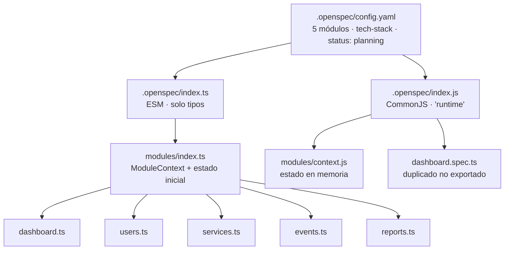

# Fase 1 — Análisis del repositorio de referencia del docente

**Proyecto:** Mi Barrio – Ciudad Granada
**Repositorio analizado:** https://github.com/paulocoronadoud/miBarrio
**Commit analizado:** `df47011` — *"Initial commit: OpenSpec configuration with TypeScript modules"*
**Fecha del commit:** 2026-11-11 (Git) / repo creado 2026-11-12 (API GitHub)
**Fecha de análisis:** 2026-11-15
**Estado:** Análisis técnico **completado**. Identificación de los 13/14 criterios del docente: **BLOQUEADA** (ver §8).

> **Corrección posterior (2026-11-15):** el usuario aclaró que los "13/14 criterios" **no son una rúbrica del docente**, sino las **13 historias de usuario HU-01…HU-13** del enunciado. El bloqueo de §8 queda **resuelto**; el análisis se conserva íntegro como evidencia de la búsqueda. Modelo vigente: [`../requerimientos/historias-usuario.md`](../requerimientos/historias-usuario.md).
>
> **Nota de vigencia:** las referencias a D-2 como “pendiente” en este documento son históricas. **D-2 fue aprobada el 2026-11-15**; el registro vigente de decisiones está en [`../arquitectura/arquitectura-solucion.md`](../arquitectura/arquitectura-solucion.md) §1 y en [`../README.md`](../README.md) §5.

---

## 1. Resumen ejecutivo

El repositorio de referencia **no es una aplicación**: es un *scaffold* de especificaciones (≈7 KB, 1 commit, 16 archivos) que declara 5 módulos funcionales en estado `planning`. No contiene frontend, API, backend, base de datos, pruebas ni documentación de requisitos.

Por lo tanto:

1. **No es posible derivar los 13/14 criterios del docente de este repositorio.** No existe ningún archivo que los enumere. Se buscó en árbol completo, historial Git, ramas, tags, issues, PRs y wiki (§8 y §2.4).
2. Sí es posible extraer **convenciones reales** que el docente usa: nomenclatura de módulos, contrato TypeScript por módulo, `config.yaml` como fuente de verdad, regla de archivos cortos (máx. 74 líneas en el repo) y separación spec/implementación.
3. El estado técnico del scaffold es **parcialmente defectuoso**: `tsc --noEmit` pasa, pero `npm run dev`, `npm run build` y `node .openspec/index.js` **fallan** (§5). Es material de arranque, no un ejemplo funcionando que se pueda copiar.
4. El repo se autodenomina "OpenSpec" pero **no sigue la estructura oficial de OpenSpec** (§4.3). Esta ambigüedad requiere una decisión explícita antes de la Fase 3.

---

## 2. Inventario verificado

### 2.1 Archivos versionados (16, sin contar `.git`)

| # | Archivo | Líneas | Contenido |
|---|---------|-------:|-----------|
| 1 | `.gitignore` | 14 | Ignora `node_modules/`, `dist/`, IDE y SO |
| 2 | `package.json` | 24 | Nombre `mi-barrio`, 3 scripts, 2 devDependencies |
| 3 | `package-lock.json` | 48 | Lockfile (solo `typescript`, `@types/node`) |
| 4 | `tsconfig.json` | 19 | ES2022, `strict: true`, `noEmit: true` |
| 5 | `.openspec/README.md` | 55 | Descripción del scaffold (único README del repo) |
| 6 | `.openspec/config.yaml` | 35 | 5 módulos + `tech-stack` |
| 7 | `.openspec/index.ts` | 13 | Punto de entrada ESM (re-exporta tipos) |
| 8 | `.openspec/index.js` | 54 | Punto de entrada CommonJS "runtime" |
| 9 | `.openspec/modules/context.js` | 74 | Gestor de estado en memoria |
| 10 | `.openspec/modules/index.ts` | 43 | `ModuleContext`, `createInitialContext`, metadata |
| 11 | `.openspec/modules/dashboard.ts` | 31 | Spec Dashboard |
| 12 | `.openspec/modules/dashboard.spec.ts` | 27 | **Duplicado** de `dashboard.ts` en sintaxis `module {}` |
| 13 | `.openspec/modules/users.ts` | 23 | Spec Usuarios |
| 14 | `.openspec/modules/services.ts` | 26 | Spec Servicios |
| 15 | `.openspec/modules/events.ts` | 28 | Spec Eventos |
| 16 | `.openspec/modules/reports.ts` | 22 | Spec Informes |

> Total confirmado con `git ls-tree -r --name-only HEAD`: **16 archivos** (incluye `package-lock.json`).

### 2.2 Estructura real

### 2.3 Historial y actividad

| Verificación | Comando / endpoint | Resultado |
|---|---|---|
| Commits | `git log --all --oneline` | 1 commit (`df47011`) |
| Ramas | `git branch -a` | solo `master` |
| Tags | `git tag` | ninguno |
| Issues / PRs | `GET /repos/.../issues?state=all` | `[]` (0) |
| Wiki | `github.com/.../wiki` | sin contenido |
| Releases | API del repo | ninguno |
| Tamaño | API del repo | 7 KB |

### 2.4 Búsqueda de los criterios del docente (negativa, documentada)

| Dónde se buscó | Resultado |
|---|---|
| Árbol completo del repo (`git ls-tree -r`) | 16 archivos, ninguno de criterios/rúbrica |
| Todos los blobs (`git log --all --name-status`) | 16 archivos en 1 commit |
| Contenido de los 16 archivos | Leídos íntegramente; sin lista de criterios |
| Ramas remotas y tags | Solo `master`; sin tags |
| Issues y Pull Requests | 0 |
| Wiki | Vacía |
| `GET /contents/` de la API GitHub | Mismos 5 ítems raíz que el clon |
| README raíz | **No existe** |

**Conclusión:** la lista de 13/14 criterios **no está en el repositorio**. No se sustituye por inferencia.

---

## 3. Contenido sustantivo del repo

### 3.1 `config.yaml` — fuente de verdad declarada

5 módulos, todos `status: planning`:

| id | Nombre | Descripción declarada |
|---|---|---|
| `dashboard` | Dashboard Principal | Panel con métricas y estadísticas del barrio |
| `users` | Gestión de Usuarios | Residentes, voluntarios y personal |
| `services` | Servicios Comunitarios | Registro y gestión de servicios locales |
| `events` | Eventos y Actividades | Calendarización de actividades comunitarias |
| `reports` | Informes y Estadísticas | Reportes para tomadores de decisiones |

`tech-stack`: `frontend: webapp`, `language: JavaScript/TypeScript`, `framework: React`, `database: PostgreSQL`.

> Observación: el stack declarado (React + PostgreSQL) coincide parcialmente con lo pedido en el proyecto (React/TS/Tailwind/Leaflet + Node/Express/PostGIS), pero el repo **no declara Express, TypeScript en backend, PostGIS, Tailwind ni Leaflet**.

### 3.2 Convención de contrato por módulo

Cada módulo exporta **dos artefactos**:

1. Una **interfaz de entidad** (`User`, `Service`, `Event`, `ReportData`, `MetricsState`).
2. Una **interfaz `Actions`** con operaciones async tipo CRUD + búsquedas/filtros.
3. Un **estado inicial** exportado (`defaultState`, `defaultUserState`, `defaultServicesState`, `defaultEventsState`, `defaultReportsState`).

Patrón recurrente y aprovechable: *contrato primero, implementación después*. Es exactamente el enfoque que conviene replicar en Mi Barrio para las tres capas.

### 3.3 Duplicación detectada

`dashboard.ts` y `dashboard.spec.ts` contienen la **misma información** (interfaces `MetricsState` y `Actions`, mismo `defaultState`). El `.spec.ts` usa sintaxis `module dashboard { ... }` y **no exporta nada**, por lo que no es consumible ni es una prueba.

---

## 4. Convenciones que el repositorio sí establece

| # | Convención | Evidencia | ¿Aplicable a Mi Barrio? |
|---|---|---|---|
| C-1 | Spec antes de código (módulos en `planning`) | `config.yaml`, README §Getting Started | Sí |
| C-2 | Un módulo = una carpeta/unidad con contrato propio | `.openspec/modules/*` | Sí, adaptado a 3 repos |
| C-3 | `config.yaml` como registro de módulos y stack | `config.yaml` | Sí (metadatos del proyecto) |
| C-4 | TypeScript `strict: true` | `tsconfig.json` | Sí, obligatorio |
| C-5 | Archivos muy cortos (máx. observado: 74 líneas) | §2.1 | Sí — refuerza la regla de ≤100 |
| C-6 | Estado inicial explícito y tipado por módulo | `default*State` | Sí (fixtures/seed) |
| C-7 | Separación de tipos y runtime (`index.ts` vs `index.js`) | `.openspec/index.*` | No — es un defecto, no una convención |
| C-8 | Documentación dentro de la carpeta de especificación | `.openspec/README.md` | Parcial — nosotros necesitamos README raíz |

### 4.3 Ambigüedad "OpenSpec"

El README dice *"This project uses the OpenSpec architecture"*, pero el repo **no** contiene la estructura del framework OpenSpec (`openspec/project.md`, `openspec/specs/`, `openspec/changes/<cambio>/{proposal,design,tasks}.md`, requisitos en Markdown con `SHALL` y escenarios `WHEN/THEN`). Lo que hay es un formato propio: `.openspec/config.yaml` + módulos `.ts`.

**Decisión pendiente (D-2):** ¿usamos el formato propio del docente, el OpenSpec oficial, o ambos (oficial para especificaciones + `config.yaml` del docente como índice)? No se decide sin aprobación.

---

## 5. Verificación técnica ejecutada (evidencia real)

Comandos ejecutados en el clon, Node v24.13.1 / npm 11.8.0 / TypeScript del lockfile.

| # | Comando | Resultado | Interpretación |
|---|---|---|---|
| V-1 | `npm install` | OK, 2 paquetes | Dependencias mínimas |
| V-2 | `npx tsc --noEmit` | **exit 0**, sin salida | Los `.ts` compilan |
| V-3 | `node .openspec/index.js` | **exit 1** — `SyntaxError: Unexpected identifier 'web'` | `require('./config.yaml')` no es válido en Node |
| V-4 | `npm run build` | **exit 1** — `TS6054: File '.openspec' has an unsupported extension` | Script inválido (`tsc .openspec`) |
| V-5 | `npm run dev` | **exit 1** — `"tsx" no se reconoce` | `tsx` se usa pero no está en `devDependencies` |
| V-6 | `npm test` | **no existe** | No hay runner ni script de pruebas |
| V-7 | Conteo de líneas | máx. 74 (`context.js`) | Cumple ≤100 |

### 5.1 Defectos verificados en el scaffold

| ID | Severidad | Defecto | Evidencia |
|---|---|---|---|
| H-1 | Alta | `index.js` es inejecutable: requiere YAML | V-3 |
| H-2 | Alta | `index.js` requiere `*.spec.js` inexistentes | `index.js` líneas 13-17 vs árbol real |
| H-3 | Alta | `npm run build` y `npm run dev` no funcionan | V-4, V-5 |
| H-4 | Media | Solo `dashboard` exporta `defaultState`; el runtime busca `module.defaultState` y los demás exportan `default*State` | `index.js` línea 38 vs `users.ts` línea 23 |
| H-5 | Media | `dashboard.spec.ts` duplica `dashboard.ts` y no exporta | §3.3 |
| H-6 | Media | README lista `users.spec.ts`, `services.spec.ts`, `events.spec.ts`, `reports.spec.ts` que **no existen** | README líneas 16-19 |
| H-7 | Media | README enlaza `../config.yaml`, pero el archivo está en la misma carpeta | README línea 48 |
| H-8 | Media | Licencia contradictoria: `package.json` = MIT, README = "Proprietary / All rights reserved" | `package.json` línea 19 |
| H-9 | Baja | `reports.ts` usa `any` (línea 5) con `strict: true` | `reports.ts` |
| H-10 | Baja | `events.ts` exporta `interface Event`, colisiona con `Event` del DOM | `events.ts` línea 1 |
| H-11 | Baja | Sin README raíz, sin LICENSE, sin CI, sin linter, sin formatter | Árbol |
| H-12 | Baja | `.gitignore` duplica `.DS_Store` y `Thumbs.db` | `.gitignore` |

**Lectura de conjunto:** el docente entregó un **esqueleto de intención**, no una referencia de calidad. Mi Barrio debe superarlo en: README raíz, ejecutabilidad real, pruebas, CI, licencia coherente y trazabilidad requisito→prueba.

---

## 6. Lo que el repositorio NO contiene (explícito)

- ❌ Lista/rúbrica de los 13 o 14 criterios del docente.
- ❌ Modelo de requerimientos (RF, RNF, historias, casos de uso).
- ❌ Arquitectura de 3 capas o diagramas.
- ❌ Código de frontend, API o backend.
- ❌ Modelo de datos, migraciones o esquema PostGIS.
- ❌ Pruebas (los `.spec.ts` no son pruebas ejecutables).
- ❌ CI/CD, Docker, variables de entorno, despliegue.
- ❌ README raíz, LICENSE, manuales.
- ❌ Tres repositorios separados (el repo es único).
- ❌ Datos geográficos o territoriales de Ciudad Granada.

---

## 7. Implicaciones para el proyecto

1. **Los criterios deben venir de otra fuente.** Sin ellos no se puede garantizar cumplimiento; cualquier matriz construida ahora sería inventada.
2. **El scaffold no se copia.** Se toma su filosofía (contrato antes de código, módulos pequeños, estado tipado) y se descarta su implementación defectuosa.
3. **La separación en 3 repositorios exige un repo de documentación/orquestación** (o un cuarto repo) para requisitos, diagramas y matriz de trazabilidad. El enunciado pide 3 repos de código; los artefactos académicos necesitan un hogar. Decisión pendiente (D-1).
4. **La regla ≤100 líneas es compatible** con el estilo del docente (máx. 74). Se aplicará por archivo de código, no a Markdown de documentación.

---

## 8. Criterios del docente: estado de la evidencia

> **Estado actual (2026-11-15): RESUELTO.** No eran criterios: son las 13 historias de usuario. La tabla siguiente conserva el estado histórico de la búsqueda.

| Aspecto | Estado |
|---|---|
| ¿Se encontraron los 13/14 criterios? | **NO** — porque no existían como rúbrica; son las 13 HU |
| ¿Se buscó en el repo completo, historial, ramas, tags, issues, PRs, wiki y API? | **SÍ** (§2.4) |
| ¿Se infirieron o sustituyeron? | **NO** — se pidió la fuente; el usuario aclaró el alcance |
| Matriz construida | **Estructura histórica** → `02-matriz-criterios-docente.md`; modelo vigente en `docs/requerimientos/` |
| Falta | Nada: el modelo de 13 HU está registrado |

**Solicitud concreta (histórica, ya no vigente):** se pidió el documento fuente o la URL. El usuario aclaró después que los 13 ítems son las historias de usuario del enunciado; no se requiere documentación adicional.

---

## 9. Decisiones que requieren aprobación

| ID | Decisión | Opciones | Recomendación |
|---|---|---|---|
| D-1 | Dónde viven los artefactos académicos | (a) 4.º repo `mi-barrio-docs`; (b) monorepo docs + 3 repos; (c) docs dentro del repo backend | (a) — mantiene los 3 repos limpios y cumple "no mezclar responsabilidades" |
| D-2 | Formato de especificaciones | (a) OpenSpec oficial; (b) formato del docente (`config.yaml` + módulos); (c) híbrido | (c) — `openspec/` oficial para specs y `config.yaml` como índice de módulos |
| D-3 | Criterios del docente | (a) esperar el archivo; (b) avanzar Fase 2 y cerrar matriz después | (a) — sin criterios no se puede validar el resto |
| D-4 | Fuente de verdad territorial | (a) IDECA/UAECD; (b) Datos Abiertos Bogotá; (c) OSM | Se decide en Fase 2 con verificación de capas reales |

Ninguna de estas decisiones se ejecutó todavía.

---

## 10. Requisitos de esta fase: cumplimiento

| Requisito del enunciado | Estado | Evidencia |
|---|---|---|
| Inspeccionar README y documentación | ✅ | `.openspec/README.md` leído; README raíz inexistente |
| Inspeccionar estructura de directorios | ✅ | §2.1, §2.2 |
| Inspeccionar `.openspec` | ✅ | 11 archivos leídos íntegramente |
| Inspeccionar archivos de configuración | ✅ | `package.json`, `tsconfig.json`, `config.yaml` |
| Inspeccionar especificaciones | ✅ | 6 módulos + README |
| Identificar reglas y convenciones | ✅ | §4 (8 convenciones con evidencia) |
| Identificar los 13/14 criterios | ✅ **Resuelto** | §8 — eran las 13 HU, no una rúbrica |
| Construir la matriz | ✅ Modelo y matriz vigentes | `docs/requerimientos/historias-usuario.md`, `matriz-trazabilidad.md` |
| Informar qué no se pudo consultar | ✅ | §6, §8 |
| No inventar información | ✅ | Sin criterios ni datos inventados |

---

## 11. Riesgos identificados

| ID | Riesgo | Impacto | Mitigación |
|---|---|---|---|
| R-1 | Los criterios aparecen tarde | Alto — retrabajo en todas las fases | No programar hasta tenerlos |
| R-2 | Datos del barrio no disponibles a la resolución requerida | Alto — funcionalidades del mapa | Fase 2 con inventario de capas y plan B (OSM + campo) |
| R-3 | Límite de 100 líneas forzando sobre-fragmentación | Medio — legibilidad | Dividir por responsabilidad, no por conteo |
| R-4 | Despliegue gratuito con PostGIS | Medio — costo/límites | Evaluar Neon/Supabase/Railway en Fase 4 |
| R-5 | Confundir "OpenSpec" del docente con el oficial | Medio — estructura inconsistente | Decisión D-2 |
| R-6 | Delimitación del barrio no verificada | Alto — toda la app se ancla ahí | Verificación obligatoria en Fase 2 antes de codificar |

---

## 12. Próxima fase propuesta

**Fase 2 — Investigación territorial de Ciudad Granada**, condicionada a:

1. Recibir la fuente de los 13/14 criterios (D-3).
2. Aprobar D-1 (ubicación de documentación) y D-2 (formato de specs).

Entregables de Fase 2: ficha territorial verificada, delimitación con fuente oficial, inventario de conjuntos de datos (nombre, entidad, URL, formato, fecha de consulta, cobertura, limitaciones, licencia) y evaluación de viabilidad de las 12 funcionalidades propuestas.
