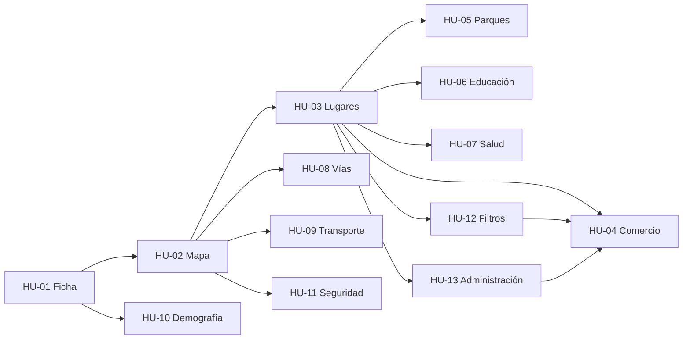

# Plan de desarrollo — Mi Barrio, Ciudad Granada

**Versión:** 1.2 · **Fecha:** 2026-11-15
**Principio:** construir primero el núcleo demostrable (ficha, mapa, catálogo, filtros) y después las funcionalidades que dependen de datos con limitaciones.
**Regla:** ninguna fase se cierra sin pruebas ejecutadas y evidencia registrada.
**Revisión 1.1 (2026-11-15):** se incorporan los ajustes de alcance de HU-04/06/09/10/11. **D-2…D-6 aprobadas**; **D-7 pendiente** para la fase administrativa y sin bloqueo para HU-01/HU-02.
**Revisión 1.2 (2026-11-15, registro histórico):** Fase 1 implementada y en pruebas con HU-01/HU-02; no cerrada ni validada. En ese momento no se había iniciado la Fase 2.

> **Estado vigente a 23 de noviembre de 2026:** las fases 1–14.7 fueron ejecutadas y Fase 14.7 está cerrada técnicamente; el despliegue gratuito en Render se ejecutó en Fase 15.2. D-2…D-7 aprobadas; D-7 implementada con evidencia. La matriz canónica registra 46/46 criterios aprobados acumulados; el run remoto `44979541605` (`success`, 36/36 en 15 archivos) es regresión, no ejecución individual de los 46. Los seis manuales y la documentación de despliegue ya existen. P0-01 APROBADO en Fase 15.3; P0-02 aprobado para la integridad consultada. La publicación del portal y el enlace único ya están resueltos en <https://chellunette-cloud.github.io/mi-barrio-entrega/>; siguen pendientes documentación final, PT-01, PT-02, auditoría WCAG formal y aceptación académica.

---

## 1. Secuencia de fases

```mermaid
gantt
  title Secuencia propuesta (duración relativa)
  dateFormat  X
  axisFormat  %s
  section Núcleo
  Fase 1 Fundaciones + HU-01/02      :f1, 0, 10
  section Catálogo
  Fase 2 HU-03 + HU-12               :f2, after f1, 8
  section Equipamientos
  Fase 3 HU-05/06/07/08/09           :f3, after f2, 12
  section Administración
  Fase 4 HU-13                       :f4, after f3, 7
  section Contexto
  Fase 5 HU-04/10/11                 :f5, after f4, 9
  section Cierre
  Fase 6 Calidad y despliegue        :f6, after f5, 8
```

| Fase | Historias | Depende de | Duración estimada |
|------|-----------|------------|-------------------|
| 1 | HU-01, HU-02 | — | 10 días |
| 2 | HU-03, HU-12 | Fase 1 | 8 días |
| 3 | HU-05, HU-06, HU-07, HU-08, HU-09 | Fase 2 | 12 días |
| 4 | HU-13 | Fase 3 | 7 días |
| 5 | HU-04, HU-10, HU-11 | Fase 4 | 9 días |
| 6 | Calidad, despliegue y entrega | Fase 5 | 8 días |

> Las duraciones son estimaciones de planificación, no compromisos. Se ajustan al cerrar cada fase.

---

## 2. Fase 1 — Fundaciones y núcleo territorial

**Historias:** HU-01 (información general), HU-02 (ubicación geográfica).

**Estado:** implementada y **en pruebas** (2026-11-15). Evidencia en
[`../evidencias/fase-1/README.md`](../evidencias/fase-1/README.md). No cerrada: faltan PT-01, auditoría
formal de accesibilidad y staging HTTPS.

**Objetivo:** tener una aplicación desplegable que muestre la ficha oficial del barrio y su polígono en un mapa, con la arquitectura de tres capas funcionando de extremo a extremo.

**Módulos involucrados**
- Frontend: `app`, `features/barrio`, `features/map`, `shared`.
- API: `routes/barrio`, `controllers/barrio`, `schemas/barrio`, `middlewares`.
- Backend: `domain/barrio`, `domain/geo`, `infra/db`, `etl/barrio`, `etl/estrato`.
- Infraestructura: repositorios, CI, base PostGIS, migraciones.

**Dependencias:** ninguna. Requiere el polígono y la ficha verificados (F-01, F-02).

**Entregables**
1. Tres repositorios con README, `.gitignore`, `.env.example` y estructura modular.
2. Pipeline CI con lint, tipos, pruebas y conteo de líneas.
3. Migración inicial: `barrio`, `fuente`, `barrio_fuente`, `manzana_estrato`, índices GiST.
4. ETL de ficha y polígono reproducible con fecha de corte.
5. `GET /api/v1/barrio` y `GET /api/v1/barrio/geometria`.
6. Página de inicio con ficha y mapa Leaflet con el polígono oficial.
7. Despliegue de humo (staging) con `/health`.

**Estado de entregables:** 1–6 ejecutados; 7 pendiente (no hay staging HTTPS).

**Pruebas necesarias:** UT-BAR-01, IT-BAR-01, AT-BAR-01, AT-GEO-01, GT-01, FT-HU01-01, FT-HU02-01, PT-01, auditoría de accesibilidad de la ficha.

**Estado de pruebas (2026-11-15):** ejecutadas UT-BAR-01, IT-BAR-01, AT-BAR-01, AT-GEO-01, GT-01,
FT-HU01-01, FT-HU02-01 y prueba de teclado. **PT-01 y auditoría formal de accesibilidad siguen
pendientes**; no se declaran cumplidas.

**Criterio de salida:** el polígono dibujado coincide con el oficial (centroide ≤ 5 m), la ficha muestra fuentes, CI en verde y staging accesible por HTTPS.

**Estado del criterio de salida:** polígono, fuentes y CI local/equivalentes en verde; **staging HTTPS
no ejecutado**, por lo que la Fase 1 no se cierra.

---

## 3. Fase 2 — Catálogo y filtros

**Historias:** HU-03 (lugares de interés), HU-12 (filtros del mapa).

**Objetivo:** permitir explorar un catálogo único de lugares con búsqueda y filtros consistentes entre mapa y listado.

**Módulos involucrados**
- Frontend: `features/places`, `features/filters`, `shared`.
- API: `routes/categorias`, `routes/lugares`, `controllers`, `schemas`.
- Backend: `domain/places`, `domain/categorias`, `infra/db` (consultas espaciales).
- ETL: consolidación de parques, colegios, salud y equipamientos en un catálogo curado.

**Dependencias:** Fase 1 (mapa y barrio).

**Entregables**
1. Modelo `categoria`, `lugar`, `lugar_fuente` con borrado lógico.
2. Endpoints `GET /categorias`, `GET /lugares`, `GET /lugares/{id}`.
3. Búsqueda sin tildes ni mayúsculas y filtro múltiple.
4. Listado, detalle y filtros en la UI; correspondencia exacta mapa–lista.
5. Catálogo inicial curado con fuente por registro.

**Pruebas necesarias:** UT-PLA-01, UT-PLA-02, UT-FIL-01, IT-PLA-01, AT-PLA-01/02/03/08, FT-HU03-01, FT-HU12-01, PT-02.

**Criterio de salida:** contador, mapa y listado coinciden para todo filtro; búsqueda documentada; sin lugares sin fuente.

---

## 4. Fase 3 — Equipamientos y movilidad

**Historias:** HU-05 (parques), HU-06 (educación), HU-07 (salud), HU-08 (vías), HU-09 (transporte).

**Objetivo:** completar la oferta de consulta con las capas oficiales de equipamientos, vías y transporte, respetando el nivel territorial de cada dato.

**Módulos involucrados**
- Frontend: `features/places` (variantes por categoría), `features/map` (capa de vías).
- API: `routes/lugares` (filtros), `routes/geo`.
- Backend: `domain/places`, `domain/geo`.
- ETL: parques, colegios, salud, malla vial, paraderos y estaciones.

**Dependencias:** Fase 2 (catálogo y filtros).

**Entregables**
1. Capas cargadas y deduplicadas (colegios por sede; 28 registros en bbox, 15 ≤800 m, 1 dentro).
2. Vistas de parques, educación, salud, vías y transporte.
3. Etiquetas "cercanas"/"cercanos" y "dentro del barrio" según geometría.
4. `GET /geo/vias` con jerarquía vial.
5. Distancias calculadas y ordenadas; fuente por capa.
6. **HU-09 limitada a paraderos, estaciones y portales**: sin rutas, horarios, frecuencias ni tiempos de llegada hasta que exista un GTFS estable.

**Pruebas necesarias:** UT-PLA-03/04/05/06, AT-PLA-04/05/06/07, AT-GEO-02, GT-02, FT de HU-05 a HU-09.

**Criterio de salida:** cada vista declara su nivel territorial; los colegios no se duplican y el conteo 28/15/1 es reproducible; las vías no se dibujan a mano; **HU-09 no muestra rutas, horarios ni frecuencias**.

---

## 5. Fase 4 — Administración

**Historia:** HU-13 (administración de información).

**Objetivo:** habilitar la gestión segura y auditada del catálogo, para corregir y completar datos, especialmente los de comercio.

**Módulos involucrados**
- Frontend: `features/admin`, `shared` (guard de ruta).
- API: `routes/auth`, `routes/admin`, `middlewares/auth`, `middlewares/rate-limit`.
- Backend: `domain/auth`, `domain/admin`, `domain/auditoria`.

**Dependencias:** Fase 3 (catálogo completo).

**Entregables**
1. Login de administrador con JWT y refresh.
2. CRUD de lugares y categorías con validación y auditoría.
3. Regla de coordenadas dentro del área de influencia.
4. Protección de borrado de categorías con lugares.
5. Panel con tabla, formulario y estados de error.

**Pruebas necesarias:** UT-ADM-01, IT-ADM-01, ST-01, AT-ADM-01/02, FT-HU13-01.

**Criterio de salida:** 401 sin sesión, validación por campo, auditoría con antes/después y rate limit verificado.

---

## 6. Fase 5 — Contexto social y comercio

**Historias:** HU-04 (comercio), HU-10 (demografía), HU-11 (seguridad y entorno).

**Objetivo:** publicar los indicadores de contexto y el comercio disponible, declarando con precisión las limitaciones de cada fuente.

**Módulos involucrados**
- Frontend: `features/places`, `features/stats`, `features/map` (capas ambientales).
- API: `routes/estadisticas`.
- Backend: `domain/stats`.
- ETL: proyecciones UPZ, estrato, delitos por localidad, cuadrante, arbolado, ronda, amenaza, gastronomía y OSM.

**Dependencias:** Fase 4 (administración para curar comercio).

**Entregables**
1. `GET /estadisticas/demografia` con **panel barrio** (estimación 3.807) y **panel UPZ 082** (proyección 133.130) separados por nivel y año.
2. `GET /estadisticas/seguridad` con cuadrante y delitos agregados por la **localidad 08 Kennedy**.
3. Vistas de demografía y seguridad con avisos de limitación y etiquetas de nivel.
4. Comercio OSM (6) + IDT (0 en el entorno) con aviso de **cobertura parcial y no totalidad**, y posibilidad de curación.
5. Capas ambientales con fuente y escala.

**Pruebas necesarias:** UT-STA-01/02, AT-STA-01/02, UT-PLA-02, AT-PLA-03, FT-HU04-01, FT-HU10-01, FT-HU11-01.

**Criterio de salida:** ningún dato de UPZ se presenta como de barrio; ninguna cifra de delitos se desagrega por barrio; el comercio declara que no es exhaustivo.

---

## 7. Fase 6 — Calidad, despliegue y entrega

**Historias:** todas (verificación final).

**Objetivo:** cerrar la matriz de trazabilidad con evidencia real, desplegar en producción y entregar documentación.

**Entregables**
1. Suite completa ejecutada (unitaria, integración, API, E2E, geográfica, seguridad, rendimiento, accesibilidad).
2. Reporte de cobertura y conteo de líneas por archivo.
3. Despliegue productivo con HTTPS, variables documentadas y respaldo.
4. Manual de usuario y manual técnico.
5. Matriz de trazabilidad actualizada con evidencia y estado real.
6. Informe de cumplimiento de calidad (SOLID, capas, repos, 100 líneas, seguridad, accesibilidad).

**Pruebas necesarias:** todas las de la matriz; auditoría final de accesibilidad; verificación de licencias y atribuciones.

**Criterio de salida:** 13/13 historias con evidencia enlazada o limitación declarada; aplicación usable desde Internet; ningún archivo > 100 líneas.

---

## 8. Dependencias entre historias

**Camino crítico:** HU-01 → HU-02 → HU-03 → HU-12 → HU-13 → HU-04 → cierre.

---

## 9. Trabajo paralelizable

| Puede ir en paralelo | Condición |
|----------------------|------------|
| HU-08 y HU-09 con HU-05/06/07 | Dependen solo de HU-02 y del ETL de su capa |
| HU-10 con HU-05..09 | Depende de HU-01 y del ETL de proyecciones |
| Documentación y ETL con desarrollo | No bloquean contratos ya acordados |
| Pruebas E2E de fases cerradas | Con ambientes estables |

---

## 10. Definición de terminado (por historia)

Una historia se considera terminada solo si:

1. Cumple todos sus criterios de aceptación con prueba ejecutada.
2. Tiene endpoint, UI y fuente de datos verificados.
3. Pasa lint, tipos y pruebas en CI.
4. Todos sus archivos tienen ≤ 100 líneas.
5. Declara su nivel territorial y su fuente en la interfaz.
6. Está registrada en la matriz de trazabilidad con evidencia enlazada.
7. Fue revisada contra accesibilidad y responsive.

---

## 11. Riesgos del plan

| Riesgo | Fase | Mitigación |
|--------|------|------------|
| ETL de una fuente falla o cambia | 3 y 5 | Respaldo local con fecha de corte y validación de esquema |
| Servicio de turismo lento (F-13) | 5 | Carga por lote con timeout y reintento; si falla, se declara |
| Datos de delitos mal interpretados | 5 | Diccionario de campos validado antes de publicar |
| Sobrecarga del límite de 100 líneas | todas | Dividir por caso de uso, no por línea |
| Tiempo insuficiente para 13 HU | todas | Prioridad alta primero; las bajas se entregan con limitación declarada |
| Hosting gratuito con suspensión | 6 | Documentar alternativas y respaldo de base |

---

## 12. Estado actual

### 12.1 Estado vigente (2026-11-22)

| Ámbito | Situación |
|---|---|
| Requerimientos, criterios, trazabilidad, investigación, especificaciones, arquitectura y plan | Documentados; la matriz vigente es [`../evidencias/fase-13/matriz-global-46-criterios.md`](../evidencias/fase-13/matriz-global-46-criterios.md), con **46/46 criterios aprobados** |
| Desarrollo funcional | Avanzado: fases 1–14.7 ejecutadas en los tres repositorios publicados en `main` |
| Validaciones técnicas | Avanzadas: regresión E2E remota de Fase 14.7, run `44979541605` (`success`, 36/36 pruebas en 15 archivos), con artefacto `playwright-report` verificado |
| Estado de Fase 14.7 | **Cerrada técnicamente**; no equivale a cierre académico ni a despliegue |
| Pendiente | Entrega final, PT-01, PT-02, auditoría WCAG formal y aceptación académica. El despliegue, la publicación del portal y el enlace único ya están ejecutados. Los seis manuales y la documentación de despliegue están disponibles. |

La evidencia remota se detalla en [`../evidencias/fase-14-7/ejecucion-e2e-remota.md`](../evidencias/fase-14-7/ejecucion-e2e-remota.md). Ese run cubre los recorridos de los 15 archivos de pruebas; **no ejecutó individualmente los 46 criterios** y **no implica que el sistema esté desplegado**.

### 12.2 Registro histórico de la planificación (2026-11-15)

La tabla y el párrafo siguientes conservan lo previsto originalmente y **no describen la situación vigente**:

| Fase | Estado histórico |
|------|------------------|
| Requerimientos, criterios, trazabilidad, investigación, especificaciones, arquitectura, plan | ✅ Documentados |
| Fase 1 — Fundaciones y núcleo | 🟡 Implementada y en pruebas — no cerrada; faltan PT-01, auditoría formal de accesibilidad y staging HTTPS |
| Fases 2 a 6 | ⬜ No iniciadas |

La Fase 1 está implementada con HU-01/HU-02 y evidencia real en
[`../evidencias/fase-1/README.md`](../evidencias/fase-1/README.md). **No se declaró `Validada`** y no se
inició la Fase 2. Los pendientes que impiden cerrar la fase son PT-01, la auditoría formal de
accesibilidad y el staging HTTPS. **D-7 no bloquea HU-01/HU-02.** Las fases 2–14.7 se ejecutaron después; este registro se mantiene como planificación original, no como estado actual.
